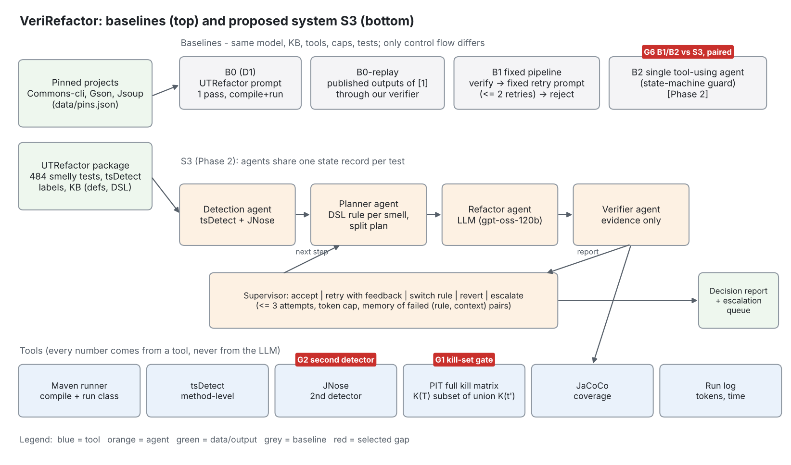

# VeriRefactor: Agentic Test-Debt Management (AI4015 Semester Project, G2)

Group: M Saqib Atif (23I-0769), Gulsher Khan (23I-0066), Hasan Altaf (23I-0698). Supervisor: Meemon Khan.

Goal: refactor test smells in Java/JUnit projects. A refactoring is accepted only when tools show it is safe: it
compiles, it passes, the targeted smells are gone (tsDetect, and JNose with G2), and the test still kills every
mutant the original killed (PIT). Base paper: UTRefactor (FSE 2025) [1].



Selected gaps: **G1** a refactoring must not weaken the test (kill-set gate), **G2** smell presence and removal
confirmed by two detectors (tsDetect + JNose consensus), **G6** adaptive supervision instead of a fixed retry script
(S3 vs B1 and B2). Each has a switch for the ablation.

## Systems (selected with `--system`, same model, KB, tools, caps and tests)

| Flag | System | Status |
|---|---|---|
| `b0replay` | UTRefactor's **published** refactorings run through our verifier. No LLM calls. | working |
| `b0` | UTRefactor reproduction: KB prompt (smell definition, DSL rule, checkpoints), 1 pass, accepted if it compiles and passes | working |
| `b1` | Fixed pipeline: KB prompt, then verify. One fixed retry prompt carries the error text, up to 2 retries, then reject | working |
| `single` | Plain prompt with no KB (the "direct LLM" reference in [1]) | working |
| `s3` | Multi-agent system: Detection, Planner (LLM-written JSON plan, KB rule fallback), Refactor and Verifier agents under an adaptive Supervisor (accept, retry, switch strategy, narrow targets, revert to the best attempt, escalate; memory of failed proposals within a test and of failed approaches across tests). `--policy fixed` and `--memory off` switch G6 parts off for the ablation | working (G6); G1 gate (`--killset-gate`) and G2 consensus (`--detector`) merged |
| `b2` | Single tool-using agent: one LLM loop that picks its own tool each reply (`detect`, `compile_and_run`, `pit`, `submit`), same KB prompt, verifier and token cap as S3, no Supervisor policy. Isolates G6 | working |

## Status

| Component | State |
|---|---|
| LLM client: logged, cached, rate-limited, `.env`; Cerebras `gpt-oss-120b` | working, smoke-tested |
| Contracts (`TestRef`, `DebtFinding`, `RefactorProposal`, `VerificationReport`, `RunState`) | done |
| Dataset: UTRefactor inputs, projects pinned to matching commits (98-99% verbatim) | done, 484 tests |
| tsDetect wrapper, method-level | working; reproduces 100% of the paper's labels |
| Maven runner (compile and run one class, per-project `JAVA_HOME`) | working in WSL |
| Fast runner (Maven once per module, then javac + JUnit launcher per test) | working in WSL (about 4 s per test) |
| PIT kill-set (full mutation matrix; union over split tests) | working on all three projects; used in every reported run |
| Verifier: patch, checks, smells, compile, run, kill-set, always restore | done, tested with real `javac` |
| Pipelines `b0replay`, `b0`, `b1`, `single`; resumable runs; metrics and decision report | done |
| First results | `docs/results_phase1.md`: b0replay on Commons-cli, b0 LLM pilot, Gson error analysis |
| S3: Detection, LLM Planner (schema fallback), Refactor, Verifier under the adaptive Supervisor; memory within and across tests | working (mock and real runs) |
| B2 single tool-using agent; human review queue (`testdebt review`) | working |
| Trajectories (one JSON event per step), per-test error capture, daily token cap, `testdebt` CLI | working |
| G2: JNose second detector, consensus targets (`--detector`), rule ii strict reduction; detector agreement (`results/E4/`) | merged (Hasan, `team/hasan/`) |
| Statistics, failure categories and case export, manual-sample labelling, figures, gap table, reference check | merged (Hasan, `team/hasan/`) |
| G1 kill-set gate, experiment runner E1-E6, CI | merged (Gulsher, `team/gulsher/`) |
| JaCoCo coverage | not implemented: the PIT kill-set is the test-strength measure |

## Quick start (WSL / Ubuntu)

```bash
bash scripts/install_env.sh                 # JDK 17 + Maven 3.9.9 (one time; asks for sudo)
export PATH=$HOME/apache-maven-3.9.9/bin:$PATH
python3 -m venv .venv && source .venv/bin/activate
pip install -r requirements.txt && pip install -e .
cp .env.example .env                        # then put your Cerebras key in .env
python3 -m pytest -q                        # 99 passed, 2 skipped (with Java); no network needed
bash scripts/setup_projects.sh              # clones UTRefactor + 3 projects, pins commits, builds data/eval_set*.jsonl
bash src/testdebt/team/hasan/get_jnose.sh   # JNose jars (second detector, G2); needs Java 21 to run
bash scripts/check_builds.sh                # week-1 gate: each pinned project builds and a test class passes
python3 scripts/smoke_test.py               # one LLM call
bash scripts/phase1_pilots.sh               # PIT pilot + b0replay/single/b0/b1/s3 on 10 Commons-cli tests -> results/phase1/
```

### Runs

After `pip install -e .` the `testdebt` command is available: `testdebt run <flags>` is the same as
`python3 -m testdebt.cli <flags>` (the `run` may be left out), and `testdebt experiment`, `testdebt summarize`,
`testdebt trace` and `testdebt review` reach the experiment runner, the trajectory viewer and the review queue.

```bash
# no LLM: measure UTRefactor's own outputs on all 484 tests (add --pit for kill-sets; slow)
python3 -m testdebt.cli --system b0replay --split all
# tuning and debugging: dev split only (80 tests)
python3 -m testdebt.cli --system s3 --split dev --seed 1
# G6 comparison: a single tool-using agent with the same tools and cap
python3 -m testdebt.cli --system b2 --split dev --seed 1
# G6 ablations: B1's fixed retry script inside S3, or S3 without memory
python3 -m testdebt.cli --system s3 --split dev --seed 1 --policy fixed
python3 -m testdebt.cli --system s3 --split dev --seed 1 --memory off
# reported runs: test split (150 tests), 3 seeds, only from a clean tree (--frozen records the commit)
for s in 1 2 3; do python3 -m testdebt.cli --system b1 --split test --frozen --seed $s; done
# pilot: tokens per test, no Maven
python3 -m testdebt.cli --system b0 --split dev --limit 10 --skip-verify
# recompute metrics for a run
python3 -m testdebt.cli --report runs/<run_id>
```

Speed: by default (`--runner fast`) Maven runs once per module to compile and record the classpath. After that,
each refactored test is compiled alone with `javac` and its class is run with the JUnit launcher, which takes a few
seconds instead of the 20-60 s of a full `mvn test`. If the original class does not pass on the fast path but does
pass under Maven, that class falls back to Maven automatically. Use `--runner maven` to force Maven for everything.

Each run writes these files to `runs/<run_id>/`:

- `config.json` (also records `split`, `frozen`, `git_commit`, `git_dirty`)
- `state.jsonl`: one record per test, with every attempt, its error and the verdict
- `decisions.json`
- `report.json`
- `report.md`
- `trajectories/<test>.jsonl`: one event per agent step (LLM calls with prompt, reply and reasoning; tool calls with
  their output; decisions and state changes). Long texts are cut and kept whole in `blobs/`. Print one as a
  timeline with `python3 -m testdebt.trace runs/<run_id> '<project>:<Class>#<method>'`.

Escalated S3 tests wait for a person: `python3 -m testdebt.review runs/<run_id>` shows each one (diff of the last
attempt, why it failed, lost mutants) and records accept / reject / note in `escalations.jsonl`;
`--list` shows the queue and `--summary` counts the decisions. Human decisions never change the automatic metrics.

Daily token budget: `llm.daily_token_cap` in `configs/default.json` (950,000, under the free tier's 1M tokens/day;
0 turns it off) counts today's non-cached tokens from `runs/llm_calls.jsonl`. When it is reached the run stops with
exit code 3 before the next LLM call; the test in progress is not recorded, so running the same command with the same
`--run-id` the next day resumes from it.

Re-running with the same `--run-id` resumes the run. A test that raised an exception (LLM, Maven, PIT, detector)
is recorded with decision `error` and the run continues; resuming retries those tests. `runs/` is not committed; the runs quoted in the docs are
copied to `results/phase1/<run_id>/` (report, decisions, config).

With `--skip-verify` nothing is compiled or run. The report then shows `accepted_rate` as `-` and counts
`accepted_unverified` instead, so a static-only run is never mistaken for an acceptance rate.

### Reproduce E1-E6 (one command)

```bash
bash experiments/run_all.sh                          # test split, frozen -> results/E1..E6, failures, figures, gap table into this README
SPLIT=dev LIMIT=2 bash experiments/run_all.sh        # smoke run on dev -> results/dev/
# the runner is src/testdebt/team/gulsher/experiments.py; seeds per config are in team/gulsher/experiments/E*.json
# reduced grid (a full test-split run of s3 with PIT takes hours): E3 and E5 -G1 use seeds 1-3, the rest seed 1
# PIT_THREADS=8 bash experiments/run_all.sh   # more PIT threads on a many-core machine (default 2)
# one system, one seed, gaps chosen by name (gap1 kill-set gate, gap2 consensus detector, gap6 adaptive supervisor):
python -m experiments.run_experiment --system s3 --split dev --limit 5 --gaps gap1,gap2,gap6 --seed 1
testdebt --system s3 --split dev --limit 5 --gaps gap2,gap6      # same switches on the CLI; gap1 off = PIT measures, never rejects
python -m veriref --help                                          # alias of testdebt (dataset-based: no --input FooTest.java mode)
```

`run_system(cfg, gaps, seed, trace_dir)` in `experiments/run_experiment.py` returns one flat metrics dict per seed: report
metrics, tool calls, retries, recovery rate, latency, tokens, and the reproducibility fields (model, temperature,
prompt hash, seed, git commit). Every trajectory ends with a `final` event carrying `failure_mode` when the test was not accepted.
E1 b0replay, E2 baselines (b0replay, b0, b1, single, b2), E3 full S3, E4 detector agreement, E5 ablations (-G1, -G2, -G6),
E6 efficiency and reliability (from the E3 runs; cost is $0 on the Cerebras free tier, token counts are reported).

### Data splits

`data/splits/{dev,test,rest}.jsonl` hold test IDs only and were built once (commit `0e1f7da`) with
`python3 -m testdebt.data.splits --seed 1` (stratified by project x single/multi smell; dev seed 1, test seed 2).

| Split | Tests | Commons-cli / Gson / Jsoup | Used for |
|---|---|---|---|
| `dev` | 80 | 13 / 39 / 28 | prompt, threshold and cap tuning, debugging, devlog measurements |
| `test` | 150 | 24 / 74 / 52 | E1-E6 LLM runs (needs `--frozen`); never for design decisions |
| `rest` | 254 | 40 / 125 / 89 | no-LLM runs only (b0replay, detector agreement) |

## Gap-resolution table

Generated from `results/` (`python3 -m testdebt.team.hasan.gap_table --readme README.md`); never typed by hand.

<!-- gap-table -->
| Gap | Method / component | Metric | Base paper result | Our result (S3) | Addressed? |
|---|---|---|---|---|---|
| G1 | Kill-set gate (`killset_gate.py`) | Accepted outputs losing a mutant (%) | 1.2 (b0, reproduced); 3.4 (b0replay, reproduced) | 0 | Fully |
| G2 | Consensus detector, tsDetect + JNose (`consensus.py`) | Smell reduction, rule ii (%) | 61.7 (b0, reproduced); 54.6 (b0replay, reproduced); rule i: 86 / 89 / 91 (reported in [1]) | 52.47 ± 1.7 | Partially |
| G6 | Adaptive Supervisor + memory (`agents/supervisor.py`) | Accepted and safe (%) | 26.7 (b0, reproduced); 11.8 (b0replay, reproduced) | 25.8 ± 1.56 | Not |
<!-- /gap-table -->

## Phase 2 results (test split, 150 tests)

Numbers from `results/` (mean ± sd over three seeds for `s3` and `s3-G1`, one seed otherwise). Full tables: `paper/tables/`.

| System | Accepted % | Accepted and safe % | Accepted outputs losing a mutant % | Tokens/test |
|---|---|---|---|---|
| `b0replay` (UTRefactor's published outputs, 484 tests) | 18.4 | 11.8 | 3.4 | 0 |
| `b0` (UTRefactor's prompt, our model) | 54.7 | 26.7 | 1.2 | 3,183 |
| `single` (plain prompt) | 82.0 | - | - | 1,799 |
| `b1` (fixed retry script) | 41.3 | 35.3 | 0 | 8,495 |
| `b2` (single tool-using agent) | 26.7 | 24.0 | 0 | 4,121 |
| `s3` (full system) | 52.4 ± 1.0 | 25.8 ± 1.6 | 0 | 9,182 ± 146 |
| `s3`, kill-set gate off (`-G1`) | 55.1 ± 1.4 | 27.1 ± 1.0 | 8.0 ± 0.5 | 9,000 ± 140 |
| `s3`, tsDetect targets (`-G2`) | 44.7 | 39.3 | 0 | 11,228 |
| `s3`, fixed policy (`-G6`) | 51.3 | 26.0 | 0 | 6,659 |

- **G1** works: the gate keeps every accepted output at full mutant strength (paired McNemar over 450 pairs, p < 0.001).
- **G2** is partial: the detectors disagree on some smells (kappa 0.02 on ExceptionHandling), but targeting only consensus smells lowers accepted-and-safe by 15 points (seed 1; 13.5 against the three-seed mean).
- **G6** is not supported: the adaptive Supervisor is below the fixed-retry baseline `b1` (24.0 vs 35.3 % on seed 1, p = 0.003; three-seed mean 25.8 ± 1.6) and level with its own fixed policy.

Rebuild every table and figure from the run folders (unpack `hasan_runs.tgz` and `hasan_e1.tgz` into the repository root, so they land in `runs/`; no LLM calls):

```bash
X="python3 -m testdebt.team.gulsher.experiments"
for e in E1 E2 E3 E5 ES E4 E6; do $X summarize $e; done
python3 -m testdebt.team.hasan.failures runs/E3_s3_s1 runs/E3_s3_s2 runs/E3_s3_s3 --name E3
python3 -m testdebt.team.hasan.figures
python3 -m testdebt.team.hasan.gap_table --readme README.md
python3 scripts/paired_extra.py
```
Then copy the tables and figures into `paper/` as the last lines of `experiments/run_all.sh` do.

## Phase 1 feedback addressed

_Supervisor comments are not in the repo; each member must paste theirs here (`comment -> change -> commit`) before the tag._

- Candidate fixes from history: PIT baseline measured refactored code (`5cf24e3`); splits frozen (`0e1f7da`); per-test error capture (`888b2eb`).
- Base paper (UTRefactor) and gaps G1, G2, G6 are unchanged since Phase 1 (to be confirmed by Saqib; any change needs Meemon Khan's written approval).

## Changes since Phase 1

- 2026-11-05: `experiments/` package: `run_system()` wraps `testdebt run` and maps `gap1/gap2/gap6` onto `--pit`, `--detector`, `--policy/--memory`; `run_all.sh` reproduces E1-E6. Trajectories end with a `final` event.
- Evaluation set is 484 tests, not 593: the replication package has reports for 492, and 484 match the pinned commits verbatim.
- Gson is reported against its own test dependencies at the matched commit; [1] compiled it in a different setup.
- PIT baseline kill matrix is computed before patching (bug found in the Phase 1 pilot, fixed in `5cf24e3`).
- Fixed dev/test/rest split added (see Data splits); Phase 1 pilot numbers came from the first 10 Commons-cli tests and are not reused as results.
- 2026-10-25: `stratified()` allocates by largest remainder so a subset always has exactly n tests (rounding gave 79 for n=80); `data/eval_subset150.jsonl` is unchanged.
- 2026-10-25: metrics add `smell_reduction_accepted` (rule i counted over accepted outputs only) and an `errors` count.
- 2026-10-25: `testdebt` command with subcommands; daily token cap (`llm.daily_token_cap`) that stops a run cleanly so it resumes the next day.
- 2026-10-25: JaCoCo coverage, listed as a Phase 2 tool in Phase 1, is not used; test strength is measured by the PIT kill-set only.
- 2026-10-25: JNose is jnose-core 0.9.0, the last release built for Java 21 (0.9.3 fixes an IgnoredTest false positive
  but needs Java 25). S3 targets the smells both detectors confirm (`--detector consensus`); `--detector tsdetect` is the
  -G2 ablation and matches [1].
- 2026-11-06: PIT on Gson and Jsoup (JUnit 4) failed for every test because the JUnit 5 PIT plugin was always added; it is now added only to JUnit 5 projects (Commons-cli). Reusing a run id with other settings is refused (it would mix results); old smoke runs were renamed `runs/smoke_*`. `logs/` holds reported runs; `run_all.sh` writes the paper tables; ES sensitivity run (retry cap) on dev; E6 logs prompt and completion tokens.
- 2026-11-06: one experiment runner (`team/gulsher/experiments.py`, called by `experiments/run_all.sh`); `--gaps` on the CLI; gap1 off now means PIT measures but never rejects; ablation adds `minus_all`; `veriref` alias; `prompt_hash` in `config.json`; reduced seed grid.
- 2026-11-06: `requirements.txt` pinned to versions used; `data/splits/README.md` and `SHA256SUMS` added; `docs/devlog.md` created.
- 2026-11-07: all reported runs (E1, E2, E3, E5, ES) done from commit `3b992f2` with `--frozen`. To fit the free tier they ran in parallel, each configuration in its own copy of the repository with its own API key (never two runs on one key or in one folder); a run that hit a key's limit was resumed with another key. The helper scripts that did this are in `scripts/run_helpers/` (they only start, resume and package runs; they change no tracked file). Raw run folders are packaged outside git; `logs/` and `results/` hold the copies used by the paper.
- 2026-11-07: `scripts/paired_extra.py` adds the matched-target comparisons used in the paper (`results/E4/paired_extra.json`), because `s3 vs b1` mixes the effects of G2 and G6.
- 2026-11-07: gap verdicts written in `results/gap_verdicts.json` (G1 Fully, G2 Partially, G6 Not); the reasons are in the paper, Section VII.

## Initial results (Phase 1)

| Run | Tests | Accepted | Compiles | Passes | Smell reduction (tsDetect) | Tokens/test |
|---|---|---|---|---|---|---|
| b0replay, Commons-cli (UTRefactor's published outputs) | 77 | 84.4% | 87.0% | 84.4% | 86.4% (paper: 86%) | 0 |
| b0replay, all 3 projects, static only (`results/phase1/b0replay_all_skipverify`) | 483 | - | - | - | 59.9% | 0 |
| b0, Commons-cli pilot (gpt-oss-120b) | 10 | 90% | 100% | 90% | 100% | 2,462 |

Details, Gson analysis and caveats: `docs/results_phase1.md`.

G2 detector agreement (`python3 -m testdebt.team.hasan.agreement --split all`, no LLM, `results/E4/`): on all 484
original tests JNose confirms 76.2% of the 1,086 smell labels of [1] (tsDetect 100%). They agree well on most smells
(kappa 0.68-1.0) but not on ExceptionHandling (tsDetect 224, JNose 10, kappa 0.02: JNose flags only `try` blocks,
tsDetect also `throws` clauses) and DuplicateAssert (45 vs 130, kappa 0.42).


## Layout

```
src/testdebt/
  contracts.py        TestRef, DebtFinding, RefactorProposal, VerificationReport, RunState
  llm_client.py       logged/cached/rate-limited chat client (.env aware), daily token cap
  java_utils.py       mask comments/strings, find/replace JUnit test methods, find module pom
  smells.py           fast rules detector (approximation, JUnit 4 + 5); final numbers come from tsDetect
  prompts.py          UTRefactor KB lookup + its prompt template, plain prompt, fixed retry prompt
  tools/maven.py      compile + run one test class
  tools/tsdetect.py   method-level tsDetect (jar from the UTRefactor package)
  tools/pit.py        PIT via pom.pit.xml copy, full kill matrix, kill-set comparison
  verify.py           patch -> checks -> smells -> compile/run -> kill-set -> restore
  pipeline.py         control flow of b0replay / b0 / b1 / single
  agents/             S3: detection, planner, refactor agents, supervisor policy, cross-test memory; b2.py
                      (the Verifier agent is verify.py)
  data/utr_dataset.py read UTRefactor reports, pin commits
  data/build_eval_set.py  eval_set.jsonl + stratified seeded subset
  data/splits.py      fixed dev/test/rest splits
  eval/metrics.py     rates, smell reduction (rule i tsDetect, rule ii tsDetect AND JNose), kill-set loss with 95% CI, paper delta
  team/gulsher/       G1 and experiments: killset_gate.py, robustness.py, experiments.py (the E1-E6 + ES runner;
                      configs in experiments/E*.json)
  team/hasan/         G2 and evaluation: jnose.py (+ jnose/JNoseMain.java, get_jnose.sh), consensus.py, agreement.py,
                      stats.py, failures.py, manual.py (+ labelling_guide.md), figures.py, gap_table.py, check_refs.py
  trace.py            trajectory writer (runs/<run>/trajectories/) and timeline viewer
  review.py           human review queue for escalated tests (escalations.jsonl, reported separately)
  cli.py              `testdebt` CLI: run, experiment, summarize, trace, review (eval/run_baseline.py is kept as an alias)
configs/default.json  model, caps, retries, temperature, paths
data/pins.json        pinned commits + JAVA_HOME per project
data/splits/          dev/test/rest test IDs (committed, never regenerated)
data/eval_set*.jsonl  built by setup_projects.sh (not committed: contains UTRefactor's published code)
data/samples/demo/    tiny Maven project used by the tests
docs/architecture.png methodology diagram (python3 scripts/make_diagram.py)
docs/results_phase1.md
results/phase1/       committed reports of the runs quoted in the docs
results/E4/           G2 detector agreement on all 484 originals (tsDetect vs JNose, kappa per smell)
results/E*/           per experiment: summary.json (mean, sd), runs.csv, table.tex, copies of each run's report/config
logs/                 reported runs: config, state, report and compressed trajectories (see logs/README.md)
experiments/          run_all.sh (one command: E1-E6, ES, failures, figures, gap table, paper tables), run_experiment.py (run_system)
paper/tables, figures filled by run_all.sh from results/; the paper \input's them
scripts/phase1_pilots.sh  PIT pilot + LLM pilots, copies reports to results/phase1/
```

## Known limitations / to verify

- A full test-split run takes hours (PIT is about 70% of the time per test). Seeds 1-3 were run for `s3` and `s3-G1`; all other configurations have seed 1 only.
- The CLI works on the 484-test dataset, not on an arbitrary Java file (`veriref` is an alias of `testdebt`).
- JaCoCo coverage is not used (kill-set only). Rule iii (manual labelling of a 100-test sample) was not completed.
- 4-16 tests per run end in a tool error that recurs on every rerun (PIT on Jsoup's network tests and on a few Gson classes; one JNose parse error in E1). They are reported as errors, not dropped.
- The pinned Gson build requires JDK 11 to 17, and old Jsoup needs JDK 19 or lower (`-source 1.7`). `data/pins.json`
  points all three projects at JDK 17.
- The B0-replay reduction differs strongly from the paper on Gson and Jsoup (see `docs/results_phase1.md`).
  Check UTRefactor's own counting before claiming anything.
- The UTRefactor package shows no licence. We clone it and read its KB at runtime; we do not copy it into this repo.
- Never commit `.env`. Rotate any key that has been pasted into a chat.
